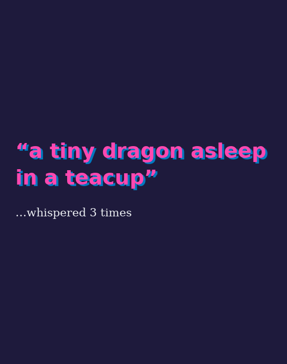
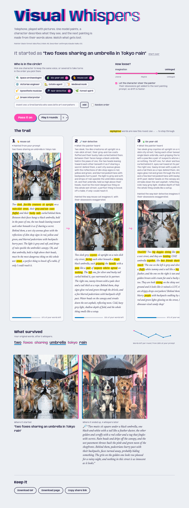

# Visual Whispers

Telephone, played with pictures. One model paints your prompt, a character looks at the painting and describes it in their own voice, and the next painting is made from that description alone. Round after round, watch what gets lost and what gets invented.



*A live round. The painting prints onto the page, then the whisper types itself out — the highlighted
words are new this round, and the bar under each card counts how much of the original prompt survived.*

## How a round works

```
your prompt ──► painter ──► image ──► character describes it ──► next painter hears only that ──► …
```

- **Who is in the circle?** Pick one character to keep the same voice, or several to take turns (space archaeologist, six-year-old, house cat, noir detective…). Invent your own too.
- **Imagination** goes from *Literal* to *Unhinged*. It changes both the instructions and the model temperature.
- **Let the character steer the painter** adds their obsessions to the next painting prompt, so the story drifts faster.
- **Play 5 rounds** runs the chain on its own. Each round streams live: the painting appears, then the whisper types itself out.
- **What survived** tracks which of your original words are still in the story, and new words are highlighted in every whisper.
- **Keep it** as an animated GIF, a self-contained web page (images embedded), or a share link.

## Quick start

```bash
cp .env.template .env        # add OPENROUTER_API_KEY (one key runs everything)
./start-local.sh             # http://localhost:3000
```

No key yet? `./start-local.sh --demo` runs the whole game offline with stand-in models.

### With Docker

```bash
docker compose up --build                   # http://localhost:8000
docker compose --profile share up --build   # plus a public ngrok link, see http://localhost:4040
```

One image, one port: the frontend is exported as static files and served by the backend.

## Models

| Role | Default | Notes |
|---|---|---|
| Describer | `anthropic/claude-haiku-5.5` via OpenRouter | Fast and good at voices. Any OpenRouter vision model works: set `DESCRIBE_MODEL`. |
| Painter | Replicate `black-forest-labs/flux-schnell` if `REPLICATE_API_TOKEN` is set | Fastest option, about 1–2 s per image. |
| | otherwise OpenRouter `black-forest-labs/flux.2-klein-4b` | So the OpenRouter key alone is enough. Any OpenRouter image model works: set `OPENROUTER_IMAGE_MODEL`. |

Images are stored by the backend (`data/`, or the `whispers-data` Docker volume), so exports and share links keep working after the providers' temporary URLs expire.

## Development

```bash
cd backend && python -m pytest      # API, providers (HTTP mocked), drift, exports
cd frontend && npm test             # pure helpers (SSE parsing, personas, highlighting)
cd frontend && npm run type-check
```

API docs live at http://localhost:8000/docs. The main endpoint, `POST /api/step`, streams Server-Sent Events: `stage → image → stage → token… → done`.

## What a finished chain looks like

Five rounds that began as *“two foxes sharing an umbrella in Tokyo rain”*, told by a house cat, a noir
detective and a six-year-old. The foxes turned into dogs; the umbrella and the rain survived.



## License

MIT
